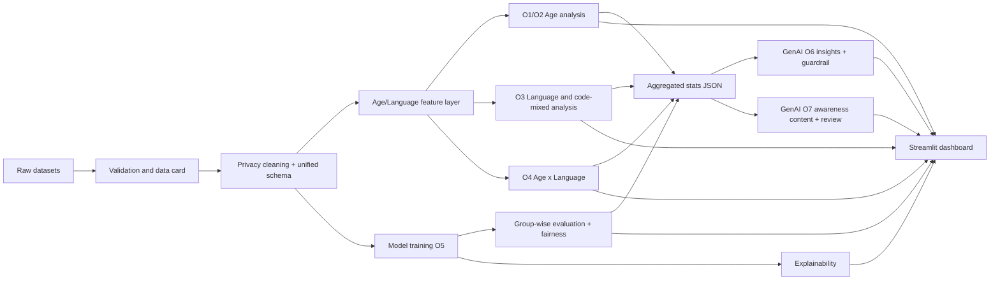

# 03 – Implementation Plan and Plan of Action

Phase-wise plan. Each phase ends with a review gate; implementation of the next phase starts only after approval.

---

## 1. Architecture



Privacy boundary: only the aggregated stats JSON crosses to any LLM.

## 2. Proposed Folder Structure

```text
Mini Project/
├── docs/                     # these documents, data cards
├── config/config.yaml        # bands, seeds, thresholds, paths
├── data/raw | interim | processed
├── src/
│   ├── data/    load.py, validate.py, clean.py, schema.py
│   ├── age/     bands.py, age_analysis.py
│   ├── lang/    detect.py, normalize.py, language_analysis.py
│   ├── combined/ age_language.py
│   ├── models/  train.py, evaluate.py, fairness.py, explain.py
│   ├── genai/   summarize.py, awareness.py, guardrails.py, prompts/
│   └── utils/   stats.py, plotting.py
├── notebooks/
├── outputs/figures | tables | reports
├── tests/
├── app.py
├── main.py
├── requirements.txt
└── README.md
```

## 3. Phases, Tasks, Deliverables, Gates

| Phase | Name | Key tasks | Deliverables | Exit gate |
|---|---|---|---|---|
| P0 | Literature and scope | Systematic search; comparison matrix of >= 15 papers; confirm gap and dataset track with supervisor | `docs/04_literature_matrix.md` | Scope and dataset decisions approved |
| P1 | Environment and skeleton | venv, pinned deps, folders, config, logging, seeds, git, `main.py` smoke test | Runnable skeleton | `python main.py` passes |
| P2 | Dataset acquisition and audit | Obtain datasets per Track; fill data cards; license check | Data cards, raw data (untracked in git) | Each dataset has a signed-off card |
| P3 | Cleaning and unified schema | PII scrubbing, dedup (exact + near), schema mapping, age-band derivation from verified ages, group-aware split | `data/processed`, preprocessing notes, tests | Leakage tests pass |
| P4 | EDA: O1, O2, O3 | Age-band tables, term log-odds, chi-square/Kruskal with FDR, effect sizes; language distribution, label by language | Figures, tables | Findings reviewed; sparse groups flagged |
| P5 | Code-mixed pipeline (part of O3) | Script/language-pattern detection, conservative normalization, 200-sample manual validation, before/after model comparison | Normalizer, validation table | Error analysis documented |
| P6 | Models and group-wise evaluation (O5) | LR, LinearSVC, ComplementNB with TF-IDF pipelines; class weights; 5-fold CV x 3 seeds; per-group metrics with bootstrap CI; optional XLM-R/MuRIL stretch | Metrics tables, confusion matrices, fairness gaps | Results reproducible from one command |
| P7 | Age + language (O4) | Cross-tab, cell-size guard, heatmaps, grouped metrics; Track C analysis if available | Combined report | Insufficient cells explicitly marked |
| P8 | Explainability | Coefficients, SHAP/LIME on a fixed example set, stability check across seeds/groups, bias commentary | Plots and examples (non-identifying) | Reviewed for misleading claims |
| P9 | GenAI O6 | Aggregates to JSON; prompt template; LLM summary; guardrail: extract numbers and verify vs JSON; reject on mismatch | Verified summaries, guardrail report | 100% numbers verified |
| P10 | GenAI O7 | Prompts for EN/HI/MR awareness text by age tone; safety rules; human review log (reviewer, date, status) | Reviewed content bank | Native-speaker review complete |
| P11 | Dashboard | Streamlit pages: Overview, Age, Language, Age x Language, Models, Explainability, GenAI, Limitations and disclaimer | `app.py` | Demo works on clean machine |
| P12 | Report and presentation | IEEE-format paper (abstract, intro, related work, dataset, method, experiments, results, ethics, threats to validity, conclusion), slides, README | `report/`, slides | Supervisor approval |

## 4. Method Details

### Preprocessing
- Preserve `text_original`; derive `text_clean`.
- Replace URLs, @handles, e-mails, phone numbers with tokens.
- Do not stem or stop-word-strip aggressively (negations and first-person pronouns carry signal).
- Language ID: fastText `lid.176` or `langdetect` as support only; validate on a manual sample; scripts via Unicode ranges (Devanagari vs Latin).

### Features
TF-IDF word 1-2 grams and character 2-5 grams (char n-grams help Romanized / code-mixed text); lexicon-based counts; length statistics.

### Models and validation
Pipelines wrapping vectorizer + classifier so vectorizer fits only on training folds. Hyperparameters tuned by nested or inner CV on training data only. Class imbalance via `class_weight='balanced'`. Report macro-F1, per-class recall, MCC, confusion matrix, bootstrap 95% CI.

### Fairness and subgroup reporting
For each group `g` with `n >= 100`: macro-F1, recall, FPR/FNR. Gap = max - min across groups. Groups below threshold shown as "insufficient n".

### Statistics
Chi-square (label vs age band) with Cramér's V; Kruskal-Wallis with epsilon-squared for numeric features; Benjamini-Hochberg correction.

### GenAI guardrails
- Input: aggregated JSON only; `n` below threshold suppressed.
- Prompt rules: cite only provided numbers, no causal claims, no diagnosis, include limitations sentence.
- Post-check: regex numbers in output must be in the JSON (with rounding tolerance).
- O7: no treatment advice; generic help-seeking and helpline placeholders; human review required before display; label "AI-generated, reviewed on <date>".

## 5. Risks and Mitigations

| Risk | Impact | Mitigation |
|---|---|---|
| No dataset with age + language + label | O4 infeasible | Tiered tracks; Track C survey; honest "insufficient data" result |
| Small subgroups | Unstable metrics | Min-n rules, bootstrap CI, band merging |
| Weak/proxy labels | Invalid risk claims | Label-type column; wording rules; per-source reporting |
| Ethics/IRB delay (Track C) | Schedule | Start approval request in P0 |
| LLM hallucination | Incorrect insights | Aggregates-only input, number guardrail, human review |
| Privacy leakage | Ethical breach | PII scrub, no raw text to LLM, no raw posts in report |
| CPU-only limits | Slow transformers | Make transformer optional stretch |

## 6. Plan of Action (Immediate)

1. Review these three documents and answer the four questions in `02_Dataset_Research_and_Analysis.md` Section 8.
2. Run P0: literature search with strings below, build comparison matrix.
3. Request supervisor approval for the dataset track and, if chosen, ethics approval for Track C.
4. On approval of P0 scope, I implement P1 (skeleton and environment) and stop for review.
5. Proceed phase by phase, each with a review gate.

### Literature search strings
- ("age" OR "age group") AND "depression detection" AND ("text" OR "social media")
- "multilingual" AND "mental health" AND ("NLP" OR "text classification")
- ("code-mixed" OR "Hinglish" OR "Marathi") AND ("depression" OR "mental health")
- "subgroup" AND "fairness" AND "mental health" AND "language model"
- "explainable" AND "depression detection" AND "social media"
- "LLM" AND "mental health" AND ("summarization" OR "psychoeducation")

### Reference-style evaluation targets (to be recorded, not assumed)
Report baseline results per dataset and compare against published figures only after verifying them in the cited papers.

## 7. Responsible-Use Statement (to appear in app and report)
This system provides research analysis of text patterns. It is not a diagnostic or screening tool, must not be used for decisions about individuals, and may be biased by language, culture and age. If you or someone you know is in distress, contact a qualified professional or a local emergency/helpline service.

## 8. Definition of Done per Phase
Code runs from a clean environment; tests pass; outputs saved under `outputs/`; documentation updated; limitations noted; reviewer sign-off recorded.
